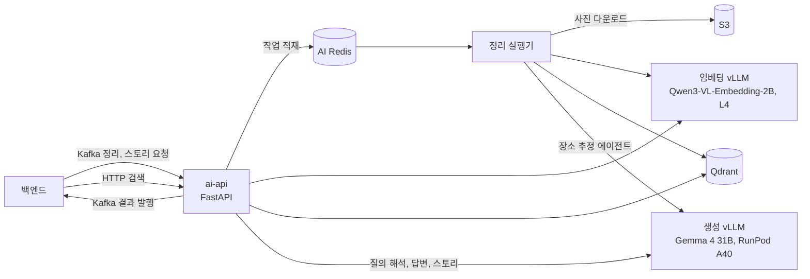

# 여담 AI 서버

여행 사진을 장소별 폴더로 자동 정리하고, 자연어로 사진을 찾거나 질문하며, 고른 사진으로 여행 스토리를 만드는 서비스 여담의 AI 서버

## 주요 기능

| 기능 | 처리 흐름 |
| --- | --- |
| 사진 자동 정리 | 업로드 사진을 임베딩하고 흐림, 중복을 판정한 뒤 촬영 위치와 시각으로 장소별 폴더 구성. 위치 정보 없는 사진은 LangGraph 정리 에이전트가 유사 사진 찾기, 장소 검색 도구를 호출해 장소 추정 |
| 자연어 사진 검색 | LLM은 질문에서 날짜, 시간대, 장소 표현만 JSON으로 추출하고 상대 날짜 계산과 조건 판정은 코드가 처리. 후보를 거른 뒤 이미지, 텍스트 임베딩 유사도로 순위를 매기고 하한과 1위 대비 비율로 반환 여부 결정, 정답 없는 질문은 거절 |
| 여행 스토리 생성 | 품질 필터와 장소별 배분으로 사진을 고르고 VLM이 한 번에 집필한 뒤 사실 검증 |

## 구성

- 업로드 요청이 AI 결과가 나올 때까지 연결을 384.6초(nginx 제한의 64%) 점유하던 v1 구조를 Kafka 이벤트 기반 비동기 처리로 전환, 중복 결과는 BE가 실행 ID로 거르도록 합의
- 정리 실행기, 임베딩 vLLM, Qdrant는 GPU EC2 한 대, 생성 vLLM은 RunPod

## 평가 체계

- 정리: 3개 기기(iPhone, 갤럭시, 디지털카메라) 사진 200장에 정답 장소를 직접 라벨링, B-cubed F1과 ARI로 자동 채점
- 검색: 개인 사진 검색 벤치마크 PhotoBench의 질의 분류를 차용한 7개 유형 51문항 테스트셋(정답 없는 질문 포함), 순위(nDCG@10), 반환(F1), 거절(Reject-F1) 분리 측정
- 재현: 고정 채점 스크립트로 변경마다 같은 데이터와 조건에서 재측정, 임계값은 별도 개발셋에서만 선택

## 성능 개선 결과

| 항목 | 변경 | 결과 | 측정 조건 |
| --- | --- | --- | --- |
| 위치 정보 없는 사진 | LangGraph 정리 에이전트 도입 | 미분류 71장 → 1장, B-cubed F1 0.637 → 0.960 | 스테이징, 200장 1회 |
| 정리 대기 시간 | 작업 시작 비용 제거, 업로드 중 임베딩, 판정 지표 사전 계산 | AI 대기 33.2초 → 3.6초, B-cubed F1 0.980 유지 | 200장, 에이전트 도입 전 파이프라인 |
| 검색 품질 | 시간대 조건 처리, 반환 기준 재선정 | 검색 F1 0.34 → 0.55, 거절 F1 0.15 → 0.60 | 테스트셋 51문항 |
| 질의 해석 지연 | vLLM 투기적 디코딩 MTP(k=2) | 질의 해석 p50 2.75초 → 1.73초, 동시 4건 처리량 71.0 → 166.5 tok/s, 검색 지표 변화 없음 | A40, 51문항 3회 |
| 사용자 정리 부담 | 위치 불명 사진에도 흐림, 중복 판정 적용 | 사용자가 직접 정리할 사진 73장 → 48장 | 200장 오프라인 |

## 기술 스택

| 영역 | 사용 |
| --- | --- |
| 모델 | Gemma 4 31B(생성), Qwen3-VL-Embedding-2B(임베딩) |
| 서빙 | vLLM, FastAPI, AWS(Fargate, EC2 g6.xlarge), RunPod |
| 에이전트 | LangGraph |
| 데이터 | Qdrant, Redis, Kafka, S3 |
| 관측 | CloudWatch Logs Insights, Prometheus |

## 문서

- [팀 위키](https://github.com/100-hours-a-week/KTB4-2nd-wiki/wiki)
- [AI 개발 블로그, 사진 정리 속도 개선 시리즈](https://medium.com/yeodam-tech)
